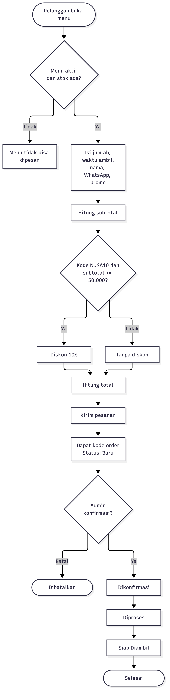

# DapurKampus

Aplikasi web pre-order makanan dari UMKM di sekitar kampus: pelanggan memesan tanpa login, admin mengelola status pesanan.

> Prototipe untuk materi workshop — semua data fiktif. Jangan memasukkan data pribadi.

## Masalah

Pedagang kecil di sekitar kampus sering menerima pesanan lewat chat yang tercecer, sehingga stok, waktu ambil, dan status pesanan sulit dilacak. DapurKampus mengumpulkan semuanya dalam satu alur sederhana.

## Fitur

Pelanggan (tanpa login):

- Melihat daftar menu aktif beserta harga dan stok.
- Memesan satu menu: jumlah, waktu ambil, nama, nomor WhatsApp, kode promo, catatan.
- Melihat subtotal, diskon, dan total langsung saat mengisi form.
- Menerima kode order berformat `DK-1234`.
- Mengecek status pesanan di halaman cek status dengan kode tersebut.
- Memasang aplikasi ke layar utama HP (PWA) lewat menu browser "Tambahkan ke Layar Utama".

Admin (login email dan kata sandi di `/admin`):

- Melihat 100 order terbaru beserta detailnya.
- Memajukan status satu langkah demi satu langkah, atau membatalkan order.

## Link aplikasi

Link aplikasi: <https://dapur-kampus-delivery.lovable.app>

## Alur



Sumber diagram ada di `docs/flowchart.mmd`. Penjelasan lengkap ada di [docs/business-rules.md](docs/business-rules.md) dan [docs/data-dictionary.md](docs/data-dictionary.md).

## Aturan promo NUSA10

Kode `NUSA10` memberi diskon 10% (dibulatkan ke rupiah terdekat) jika subtotal minimal Rp50.000. Kode harus persis huruf besar. Kode lain tidak memberi diskon.

| Harga | Jumlah | Kode | Subtotal | Diskon | Total |
|---|---|---|---|---|---|
| 25.000 | 2 | `NUSA10` | 50.000 | 5.000 | 45.000 |
| 20.000 | 2 | `NUSA10` | 40.000 | 0 | 40.000 |
| 33.333 | 2 | `NUSA10` | 66.666 | 6.667 | 59.999 |
| 25.000 | 2 | `nusa10` | 50.000 | 0 | 50.000 |

## Struktur repo

```
src/lib/pricing.ts           semua perhitungan harga (fungsi murni)
src/lib/pricing.test.ts      test untuk pricing.ts
src/lib/orders.functions.ts  server function: buat order, cek status
src/lib/order-status.ts      urutan status dan aturan pembatalan di UI
src/routes/                  halaman: index, pesan.$menuId, cek-status, admin
drizzle/migrations/          skema database (SQL)
.github/workflows/test.yml   CI: menjalankan test
docs/                        aturan bisnis, kamus data, diagram alur
```

## Cara menjalankan test

```sh
bun install
bun run test
```

GitHub Actions menjalankan perintah yang sama pada setiap push.

## Cara pengembangan

Proyek ini dapat dilanjutkan di [Lovable editor](https://lovable.dev/projects/25e7648f-c6b4-4c90-8c0e-9cdb79ba9fb4). Push ke branch `main` akan tersinkron ke Lovable. Jangan melakukan force-push atau menulis ulang riwayat commit, karena riwayat proyek di sisi Lovable bisa hilang.

## Riwayat commit

Commit awal bernama "Changes" dibuat otomatis oleh Lovable. Commit berikutnya memakai pesan deskriptif bergaya conventional commits, misalnya `feat:`, `ci:`, dan `docs:`.

## Batasan prototipe

- Satu order hanya berisi satu menu. Tidak ada pembayaran online; pembayaran dianggap di tempat.
- Harga dan total dihitung ulang di server, tetapi tidak ada pembatasan jumlah permintaan (rate limit) maupun CAPTCHA.
- Kode order hanya empat digit, sehingga bisa ditebak. Siapa pun yang tahu kodenya dapat melihat status order.
- Nomor WhatsApp tidak diverifikasi.
- Stok tidak dikembalikan saat order dibatalkan.
- Halaman `/admin` hanya untuk masuk; tombol pendaftaran sudah dihapus setelah akun admin dibuat. Pendaftaran lewat API tetap perlu dimatikan di pengaturan Auth.

## Dibuat dengan

[Lovable](https://lovable.dev), [TanStack Start](https://tanstack.com/start), Supabase (Lovable Cloud), dan [Vitest](https://vitest.dev).
